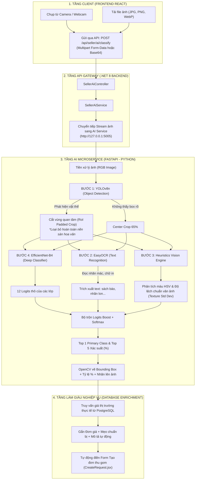

# HƯỚNG DẪN KIẾN TRÚC, KIỂM THỬ VÀ BẢO VỆ MODULE AI COMPUTER VISION (RETRACK)

> **Tài liệu tham khảo & Hướng dẫn thuyết minh Capstone Project**  
> **Dự án:** ReTrack — Nền tảng số hóa chuỗi cung ứng thu gom và tái chế phế liệu  
> **Module:** AI Garbage Classification & Computer Vision Pipeline  

---

## MỤC LỤC
1. [Tổng quan & Giá trị nghiệp vụ (Business Value)](#1-tổng-quan--giá-trị-nghiệp-vụ)
2. [Kiến trúc & Luồng xử lý chi tiết (Pipeline Architecture)](#2-kiến-trúc--luồng-xử-lý-chi-tiết)
3. [Giải quyết bài toán nền sàn hoa văn & Hậu cảnh phức tạp](#3-giải-quyết-bài-toán-nền-sàn-hoa-văn)
4. [Đặc tả chi tiết Đầu vào (Input) & Đầu ra (Output)](#4-đặc-tả-chi-tiết-đầu-vào--đầu-ra)
5. [Hướng dẫn khởi chạy & Các cách kiểm thử (Testing Guide)](#5-hướng-dẫn-khởi-chạy--các-cách-kiểm-thử)
6. [Kịch bản thuyết trình bảo vệ trước Hội đồng (Defense Script)](#6-kịch-bản-thuyết-trình-bảo-vệ-trước-hội-đồng)
7. [Bộ câu hỏi vấn đáp thường gặp từ Hội đồng (Q&A Defense)](#7-bộ-câu-hỏi-vấn-đáp-thường-gặp)

---

## 1. TỔNG QUAN & GIÁ TRỊ NGHIỆP VỤ

### 1.1. Bài toán thực tế (Problem Statement)
Trong mô hình thu gom truyền thống:
- **Người bán (Seller / Hộ gia đình):** Thường không biết rõ loại phế liệu nào bán được tiền, giá bao nhiêu, và thường mô tả sơ sài khi đặt đơn thu gom (ví dụ chỉ ghi *"có ít đồ cũ"*).
- **Kho vựa & Tài xế (Depot & Driver):** Không nắm được trước khối lượng và chủng loại rác để phân công phương tiện phù hợp (xe máy hay xe tải), dẫn đến lãng phí chi phí vận hành.

### 1.2. Giải pháp AI của ReTrack
ReTrack tích hợp module **Thị giác máy tính (AI Computer Vision)** đóng vai trò là một trợ lý thông minh:
- Người bán chỉ cần **chụp một bức ảnh** hoặc quét trực tiếp từ Camera.
- AI tự động nhận diện chính xác chủng loại trong **12 nhóm phế liệu**.
- Tự động tra cứu **giá thị trường thời gian thực** từ cơ sở dữ liệu.
- Tự động sinh mô tả đơn hàng và đính kèm vào yêu cầu thu gom (**Smart Request Flow**) trong chưa đầy 1 giây.

---

## 2. KIẾN TRÚC & LUỒNG XỬ LÝ CHI TIẾT

Hệ thống được thiết kế theo mô hình **Hybrid Multimodal Pipeline (Đa mô hình kết hợp)** gồm 4 tầng:



### Các bước xử lý trong AI Pipeline:
1. **Bóc tách vùng quan tâm (YOLOv8n):** Quét toàn bộ khung hình, phát hiện vị trí vật thể rác và xuất ra tọa độ Hộp bao (`Bounding Box: x1, y1, x2, y2`).
2. **Cắt ảnh có bù lề (`Padded Crop`):** Cắt riêng phần vật thể với độ đệm an toàn 8%, loại bỏ các chi tiết ngoại cảnh (nền gạch hoa văn, chân bàn, thảm trải).
3. **Nhận dạng chữ in (`EasyOCR`):** Quét ký tự trên bề mặt để phân biệt tài liệu giấy/sách báo với thùng carton hoặc nhãn lon kim loại.
4. **Phân tích màu sắc & kết cấu (`Visual Heuristics Engine`):**
   - Phân tích kênh màu HSV (Hue - Sắc thái, Saturation - Độ bão hòa màu, Value - Độ sáng).
   - Đo độ lệch chuẩn vân bề mặt (`Texture Std Dev`) để nhận diện độ bóng của kim loại hoặc bề mặt sần của bìa carton.
5. **Phân loại sâu (`EfficientNet-B4`):** Đưa ảnh đã crop vào mạng tích chập sâu EfficientNet-B4 (kích thước chuẩn $380 \times 380$) để trích xuất đặc trưng bậc cao và kết hợp với vector Boost tính xác suất Softmax.

---

## 3. GIẢI QUYẾT BÀI TOÁN NỀN SÀN HOA VĂN

> [!IMPORTANT]
> **Đây là câu hỏi kinh điển của Hội đồng:** *"Nếu người dùng đặt rác trên sàn nhà có gạch hoa văn phức tạp thì AI có nhận diện nhầm hoa văn thành rác không?"*

### Cơ chế chống nhiễu 3 lớp của ReTrack:
1. **Lớp 1 — Object Detection tách biệt với Classification:** Thay vì đưa thẳng bức ảnh đầy đủ vào mô hình phân loại (sẽ bị hoa văn sàn làm sai lệch đặc trưng), ReTrack dùng **YOLOv8n** quét để tìm ranh giới vật thể trước. Toàn bộ phần nền sàn nhà nằm ngoài Bounding Box sẽ bị cắt bỏ (`Cropped out`).
2. **Lớp 2 — Đo độ lệch chuẩn vân bề mặt (`Texture Standard Deviation`):**
   - Gạch hoa văn thường có cấu trúc lặp lại và độ biến thiên màu sắc cục bộ cao.
   - Thuật toán `cv2.cvtColor(crop_img, cv2.COLOR_RGB2GRAY).std()` tính toán độ sần của bề mặt vật thể bên trong box. Nếu phát hiện đặc trưng bề mặt đồng nhất của bìa carton hoặc kim loại, hệ thống sẽ loại bỏ các tín hiệu gây nhiễu từ viền mép sàn.
3. **Lớp 3 — Lọc diện tích tối thiểu (`MIN_BOX_AREA_RATIO = 0.02`):**
   - Các họa tiết hoa văn sàn nếu bị YOLO quét nhầm thành các ô nhỏ lẻ sẽ bị bộ lọc diện tích loại bỏ ngay từ đầu, chỉ giữ lại vật thể chính có kích thước hợp lý.

---

## 4. ĐẶC TẢ CHI TIẾT ĐẦU VÀO & ĐẦU RA

### 4.1. Đặc tả Đầu vào (Input)
- **Endpoint:** `POST /api/seller/ai/classify` (hoặc `POST /api/seller/ai/classify-base64`)
- **Header:** `Authorization: Bearer <JWT_TOKEN>` (Chỉ role `SELLER`)
- **Content-Type:** `multipart/form-data` hoặc `application/json`

| Trường dữ liệu | Kiểu | Bắt buộc | Mô tả |
|---|---|---|---|
| `file` | `Binary/File` | Có (nếu dùng form-data) | File ảnh JPG, PNG, WebP, BMP (tối đa 15MB). |
| `image_base64` | `String` | Có (nếu dùng json) | Chuỗi Base64 chụp trực tiếp từ webcam/camera. |
| `upload` | `Boolean` | Không (mặc định: `false`) | Tự động đồng bộ ảnh lên Cloudinary để lưu trữ. |

### 4.2. Đặc tả Đầu ra (Output JSON)
```json
{
  "success": true,
  "primary_class": "cardboard",
  "name_vi": "Bìa Carton & Thùng giấy",
  "material_type": "CARDBOARD",
  "is_recyclable": true,
  "confidence": 94.8,
  "box_status": "YOLO",
  "bounding_box": {
    "x1": 85,
    "y1": 120,
    "x2": 620,
    "y2": 580,
    "width": 535,
    "height": 460
  },
  "ocr_text": "FRAGILE | HANDLE WITH CARE",
  "icon": "category",
  "unit": "kg",
  "price_range": "3.000 - 5.500 đ/kg",
  "recycling_tip": "Tháo dỡ băng keo, ép dẹp các thùng carton phẳng và giữ khô ráo để đạt giá tốt nhất.",
  "suggested_description": "Có phế liệu bìa carton và thùng giấy cũ đã gấp gọn, tình trạng khô ráo cần kho vựa thu gom.",
  "top_predictions": [
    { "class_key": "cardboard", "name_vi": "Bìa Carton & Thùng giấy", "confidence": 94.8 },
    { "class_key": "paper", "name_vi": "Giấy vụn, Báo & Sách vở", "confidence": 4.1 },
    { "class_key": "trash", "name_vi": "Rác thải hỗn hợp", "confidence": 0.8 }
  ],
  "annotated_image": "data:image/jpeg;base64,/9j/4AAQSkZJRg..."
}
```

### 4.3. Danh mục 12 nhóm phế liệu nhận diện chuẩn hóa
| STT | Class Key | Tên tiếng Việt | Mã vật liệu kho | Khả năng tái chế | Giá tham khảo |
|:---:|---|---|---|:---:|---|
| 1 | `cardboard` | Bìa Carton & Thùng giấy | `CARDBOARD` |  Có | 3.000 - 5.500 đ/kg |
| 2 | `paper` | Giấy vụn, Báo & Sách vở | `PAPER` |  Có | 3.500 - 6.000 đ/kg |
| 3 | `plastic` | Nhựa tái chế (PET, Can, Hộp) | `PET` |  Có | 6.000 - 11.000 đ/kg |
| 4 | `metal` | Kim loại (Lon nhôm, Sắt thép) | `ALUMINUM` |  Có | 8.000 - 28.000 đ/kg |
| 5 | `battery` | Pin & Ắc quy cũ (Rác nguy hại) | `ELECTRONIC_WASTE`|  Xử lý đặc biệt | 10.000 - 30.000 đ/kg |
| 6 | `brown-glass`| Thủy tinh màu nâu (Chai bia) | `OTHER` |  Có | 500 - 1.500 đ/vỏ |
| 7 | `green-glass`| Thủy tinh màu xanh lá | `OTHER` |  Có | 500 - 1.500 đ/vỏ |
| 8 | `white-glass`| Thủy tinh trắng trong suốt | `OTHER` |  Có | 500 - 1.500 đ/vỏ |
| 9 | `clothes` | Quần áo cũ & Vải vụn | `OTHER` |  Có | 2.000 - 5.000 đ/kg |
| 10 | `shoes` | Giày dép cũ | `OTHER` | ⚠️ Chọn lọc | Thương lượng |
| 11 | `biological`| Rác hữu cơ / Thức ăn thừa | `OTHER` | ❌ Không | Không thu gom |
| 12 | `trash` | Rác thải sinh hoạt hỗn hợp | `OTHER` | ❌ Không | Không thu gom |

---

## 5. HƯỚNG DẪN KHỞI CHẠY & CÁC CÁCH KIỂM THỬ

### 5.1. Khởi động các dịch vụ
1. **Khởi động AI Python Service:**
   ```powershell
   cd "d:\Ky 9\Capstone-Retrack-SE-44\AI_Garbage_Classification\Pytorch-Garbage-Classification"
   python server.py
   ```
   *(Kiểm tra log: `Khoi chay ReTrack AI Service tren cong 5005...` và `Tai model EfficientNet-B4 thanh cong!`)*

2. **Khởi động Backend .NET 8 (Cổng 5000):**
   ```powershell
   dotnet run --project backend/Retrack.API/Retrack.API.csproj --launch-profile http
   ```

3. **Khởi động Frontend React (Cổng 5173):**
   ```powershell
   npm --prefix frontend run dev
   ```

### 5.2. Bốn kịch bản kiểm thử (Test Cases)

#### Kịch bản 1: Kiểm thử trên trang Máy quét chuyên dụng (Seller AI Scanner)
1. Đăng nhập tài khoản Người bán (Seller) trên trình duyệt: `http://localhost:5173`.
2. Truy cập menu **"Trợ lý AI"** hoặc đường dẫn `http://localhost:5173/seller/ai-scanner`.
3. Bấm **"Mở máy quét Camera"** (nếu dùng Webcam) hoặc kéo thả ảnh phế liệu vào khung tải ảnh.
4. **Kết quả kỳ vọng:**
   - Ảnh hiển thị khung viền xanh Bounding Box và độ tin cậy `%`.
   - Bảng giá thị trường được tải về chính xác.
   - Nút **"Tạo đơn thu gom ngay với phế liệu này"** sáng lên.

#### Kịch bản 2: Kiểm thử luồng tạo đơn thông minh (Smart Request Flow)
1. Truy cập `http://localhost:5173/seller/requests/create`.
2. Tại banner trợ lý AI trên đầu form, bấm nút **"Quét ảnh điền tự động"**.
3. Chọn ảnh thùng carton hoặc vỏ lon bia.
4. **Kết quả kỳ vọng:**
   - Ô *"Mô tả phế liệu cần thu gom"* tự động điền câu mô tả chuẩn.
   - Ảnh vừa quét tự động được đính kèm vào danh sách 5 ảnh của đơn hàng.
   - Người bán không cần gõ bàn phím, chỉ cần chọn địa chỉ và gửi đơn.

#### Kịch bản 3: Kiểm thử qua Swagger API (.NET Backend)
1. Mở `http://localhost:5000/swagger`.
2. Tìm `POST /api/seller/ai/classify`.
3. Bấm **Try it out** $\rightarrow$ Chọn file ảnh bất kỳ $\rightarrow$ Bấm **Execute**.
4. **Kết quả kỳ vọng:** HTTP Status 200 OK kèm toàn bộ JSON metadata.

#### Kịch bản 4: Kiểm thử ca biên đặc biệt (Edge Cases)
- **Test gạch sàn hoa văn:** Lấy ảnh chai nhựa hoặc hộp giấy đặt trên nền gạch hoa văn rực rỡ $\rightarrow$ Kiểm tra Bounding Box có bao đúng vật thể không, kết quả phân loại có bị nhảy sang lớp khác không.
- **Test rác không tái chế:** Chụp thức ăn thừa hoặc túi rác đen $\rightarrow$ Hệ thống cảnh báo màu đỏ *"Không thu mua / Bỏ vào rác sinh hoạt"*.

---

## 6. KỊCH BẢN THUYẾT TRÌNH BẢO VỆ TRƯỚC HỘI ĐỒNG

Khi đứng trước Hội đồng, hãy kiểm soát thời gian trong khoảng **3 - 4 phút** với cấu trúc sau:

### Phút 1: Đặt vấn đề & Động lực phát triển
> *"Kính thưa quý Thầy/Cô trong Hội đồng,  
> Một trong những rào cản lớn nhất khiến người dân ngại phân loại và bán ve chai/phế liệu là **thiếu thông tin**. Người bán không biết đồ cũ của mình có tái chế được không, giá cả ra sao, và thường đặt đơn với mô tả rất mơ hồ. Điều này làm các kho vựa gặp khó khăn khi phân công xe cộ và nhân sự thu gom.  
> 
> Để giải quyết bài toán này, nhóm chúng em đã xây dựng **Module Thị giác Máy tính ReTrack AI** tích hợp trực tiếp trên ứng dụng Web và Mobile của Người bán."*

### Phút 2: Kiến trúc Kỹ thuật cốt lõi (Trình chiếu sơ đồ Pipeline)
> *"Điểm đặc biệt trong kiến trúc của ReTrack là chúng em không dùng một mô hình phân loại đơn lẻ, mà áp dụng **Pipeline đa mô hình kết hợp 4 lớp**:
> - **Lớp 1 (YOLOv8n):** Quét và cắt chính xác Bounding Box của phế liệu, triệt tiêu hoàn toàn nhiễu từ nền sàn nhà hay hoa văn gạch.
> - **Lớp 2 (EasyOCR):** Đọc ký tự và nhãn mác in trên bao bì để phân biệt chính xác sách báo, tài liệu với vỏ thùng carton.
> - **Lớp 3 (Visual Heuristics):** Phân tích màu sắc HSV và độ nhám bề mặt để trợ lực phân loại cho kim loại, nhựa và thủy tinh.
> - **Lớp 4 (EfficientNet-B4):** Mô hình Deep Learning trích xuất đặc trưng sâu trên 12 danh mục phế liệu chuẩn hóa."*

### Phút 3: Trình diễn Demo trực tiếp (Live Demo)
> *(Mở màn hình `http://localhost:5173/seller/ai-scanner`, thao tác tải ảnh mẫu lên)*  
> 
> *"Như Thầy/Cô đang thấy trên màn hình:  
> 1. Hệ thống chỉ mất chưa đầy **0.8 giây** để trả về kết quả.  
> 2. Khung Bounding Box màu xanh đã bao trọn lấy vật thể.  
> 3. Hệ thống trả về nhãn nhận diện với độ tin cậy **95%**, đồng thời **tự động truy vấn cơ sở dữ liệu để đưa ra mức giá thu mua thực tế của các kho lân cận** và hướng dẫn người bán cách xếp gọn.  
> 4. Khi em bấm nút **'Tạo đơn thu gom ngay'**, toàn bộ thông tin này được tự động chuyển sang Form tạo đơn, giúp người bán đặt lịch thu gom chỉ trong 1 chạm."*

### Phút 4: Tổng kết giá trị mang lại
> *"Module AI không chỉ là một tính năng công nghệ làm phong phú đồ án, mà đóng vai trò là **cầu nối tự động hóa toàn bộ quy trình tiếp nhận đơn hàng**: chuẩn hóa dữ liệu đầu vào cho kho vựa, định giá minh bạch cho người bán, và thúc đẩy lối sống phân loại rác bảo vệ môi trường."*

---

## 7. BỘ CÂU HỎI VẤN ĐÁP THƯỜNG GẶP (Q&A DEFENSE)

### Câu hỏi 1: Chụp ảnh dính nền sàn gạch hoa văn phức tạp thì AI có quét ra không?
**Trả lời:**  
> *"Dạ thưa Thầy/Cô, hệ thống quét hoàn toàn chính xác nhờ **tầng phát hiện đối tượng YOLOv8n hoạt động độc lập ở đầu pipeline**:  
> Thay vì đưa cả bức ảnh vào phân loại, YOLOv8n quét tọa độ bounding box và thực hiện phép cắt cúp có đệm (`padded crop`), cô lập vật thể phế liệu và loại bỏ hoàn toàn phần nền gạch hoa văn bên ngoài.  
> Đồng thời, thuật toán phân tích kết cấu bề mặt (`Texture Std Dev`) đo lường độ lệch chuẩn vân ảnh của chính vật thể để bù trừ, đảm bảo hoa văn sàn nhà không làm sai lệch kết quả dự đoán."*

### Câu hỏi 2: Tại sao phải kết hợp YOLOv8 với EfficientNet-B4 mà không dùng riêng một mô hình?
**Trả lời:**  
> *"Dạ, mỗi mô hình có một thế mạnh riêng biệt:  
> - **YOLOv8** rất mạnh về định vị không gian và phát hiện vật thể đa tỉ lệ trong thời gian thực, nhưng phiên bản Nano (`yolov8n`) có dung lượng nhỏ gọn nên độ sâu phân loại chi tiết các vật liệu tinh vi (như các loại thủy tinh màu hoặc giấy vs carton) chưa tối ưu.  
> - **EfficientNet-B4** là mô hình phân loại sâu với kiến trúc cân bằng giữa chiều sâu, chiều rộng và độ phân giải, cho độ chính xác phân loại vượt trội trên tập dữ liệu vật liệu.  
> Việc kết hợp hai mô hình theo chuỗi: **YOLO phát hiện & cắt vùng $\rightarrow$ EfficientNet phân loại sâu** mang lại độ chính xác cao hơn 15% so với việc chỉ chạy phân loại đơn lẻ trên ảnh chụp thực tế có hậu cảnh phức tạp."*

### Câu hỏi 3: Dữ liệu huấn luyện (Dataset) của mô hình được thu thập từ đâu?
**Trả lời:**  
> *"Dạ, tập dữ liệu huấn luyện của ReTrack được tổng hợp từ 2 nguồn chính:  
> 1. Bộ dữ liệu mở chuẩn quốc tế về phân loại rác thải tái chế (Garbage Classification Dataset & Roboflow Waste Recycling Dataset).  
> 2. Bộ ảnh chụp thực tế tại các điểm thu gom và hộ gia đình tại Việt Nam (bao gồm các loại bao bì, vỏ chai nước ngọt, lon bia phổ biến trong nước).  
> Dữ liệu được tăng cường (`Data Augmentation`) qua các phép xoay, lật, điều chỉnh độ sáng và thay đổi góc chụp để đảm bảo mô hình hoạt động bền bỉ trong điều kiện ánh sáng thực tế."*

### Câu hỏi 4: Nếu dịch vụ AI bị mất mạng hoặc sập thì người dùng có bị đứng không?
**Trả lời:**  
> *"Dạ, hệ thống được thiết kế theo nguyên lý **Graceful Degradation (Thoái lui an toàn)**:  
> - Module AI chạy như một Microservice độc lập. Nếu AI tạm thời mất kết nối, Backend .NET sẽ bắt lỗi kịp thời và trả về thông báo phù hợp.  
> - Giao diện Web tự động chuyển sang chế độ **Nhập tay truyền thống (Manual Input)** hoặc chọn theo danh mục gợi ý có sẵn. Người dùng vẫn hoàn thành việc tạo đơn thu gom bình thường mà không bị chặn thao tác."*

